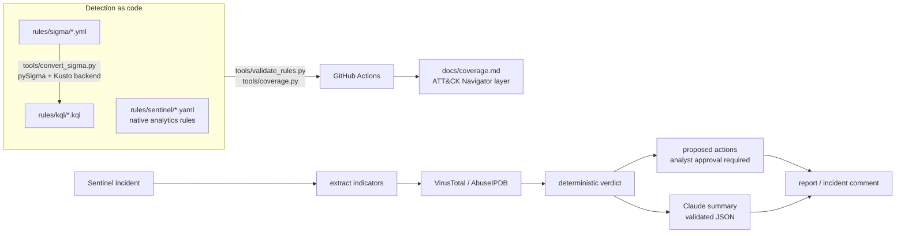

# sentinel-detection-lab

[](https://github.com/acarranza-labs/sentinel-detection-lab/actions/workflows/ci.yml)

A personal **detection-as-code** lab for Microsoft Sentinel. It has three parts:

1. **Detections**: Sigma rules converted to KQL, plus native Sentinel analytics rules, all mapped to MITRE ATT&CK.
2. **CI**: every push lints the rules, checks that the generated KQL and the ATT&CK coverage report are up to date, and runs the tests.
3. **Enrichment playbook**: takes a Sentinel incident, looks up its indicators in VirusTotal and AbuseIPDB, scores them, proposes response actions that **always need analyst approval**, and asks an LLM (Claude) for an investigation summary with guard rails.

> This is a lab built in my own time with synthetic data. It contains no client data or employer code.

---

## How it fits together



## Detections

| Rule | Type | Data source | ATT&CK |
| :--- | :--- | :--- | :--- |
| Office application spawning a script interpreter | Sigma → KQL | DeviceProcessEvents | T1204.002, T1059, T1566.001 |
| PowerShell with an encoded command | Sigma → KQL | DeviceProcessEvents | T1059.001, T1027.010 |
| Volume shadow copy deletion | Sigma → KQL | DeviceProcessEvents | T1490 |
| Certutil download or decode | Sigma → KQL | DeviceProcessEvents | T1105, T1140 |
| Password spray from a single IP | Sentinel | SigninLogs | T1110.003 |
| MFA fatigue followed by success | Sentinel | SigninLogs | T1621 |
| Inbox rule forwarding or hiding mail (BEC) | Sentinel | OfficeActivity | T1564.008, T1114.003 |
| External Teams chat posing as IT support | Sentinel | CloudAppEvents | T1566.003, T1656 |

Full coverage, including the tactics with no rule yet: [docs/coverage.md](docs/coverage.md).
To see it as a heat map, load [docs/attack-navigator-layer.json](docs/attack-navigator-layer.json) in [ATT&CK Navigator](https://mitre-attack.github.io/attack-navigator/).

**Why two formats?** Sigma keeps endpoint logic vendor-neutral, so the same rule can be converted for Sentinel, Splunk or another SIEM. Identity and Microsoft 365 detections rely on Sentinel-specific tables and KQL features (`make_bag`, `mv-expand`, joins between failures and successes), so they are written natively, in the same YAML layout as Microsoft's public analytics rule templates.

## Enrichment playbook

```bash
pip install -r requirements.txt

# Offline demo: recorded API answers, no keys and no LLM needed
python -m playbook.enrich samples/incident_mfa_fatigue.json --offline --no-llm

# Live: set VT_API_KEY, ABUSEIPDB_API_KEY and ANTHROPIC_API_KEY
python -m playbook.enrich samples/incident_phishing_attachment.json --json-out result.json
```

Design decisions:

- **The LLM writes, rules decide.** Containment proposals (block an IP, hash or URL; revoke sessions and reset the password) come from plain, readable rules in [`playbook/verdict.py`](playbook/verdict.py). The model only writes the summary, the findings and a *suggested* classification.
- **Human in the loop.** Every containment action is proposed with `requires_approval: true`. There is no code path that executes one. The only write the playbook can do is post a comment on the incident (`--post-comment`).
- **Untrusted input.** Incident text can contain attacker-written content. The phishing sample includes an email subject that tries to tell the AI to close the incident as a false positive. It reaches the model only as delimited data, and a test checks that it cannot change the proposed actions.
- **Structured output, validated twice.** The model must answer with a JSON schema (structured outputs), and the answer is validated again locally. A refusal, a truncated answer, invalid JSON, an unexpected field or an API error all fall back to a deterministic summary, so the playbook always returns a result.
- **Fail soft on threat intel.** A provider error or a rate limit is recorded as evidence ("HTTP 429"), not raised. Private IP addresses are never sent to external services.

The playbook is a CLI so it is easy to test. In production it would run as an Azure Function or a Logic App step triggered by a Sentinel automation rule, with a managed identity instead of a bearer token.

## Development

```bash
python tools/validate_rules.py          # lint rule metadata
python tools/convert_sigma.py           # regenerate rules/kql/ after editing Sigma rules
python tools/coverage.py                # regenerate the ATT&CK coverage report
python -m unittest discover -s tests -t . -v
```

To add a rule: create it in `rules/sigma/` or `rules/sentinel/`, map it to ATT&CK, document its false positives, then run the commands above. CI fails if the generated files are stale.

## Limitations

- The Sentinel-native queries are checked for structure (balanced brackets, entity columns present), not executed. Test them in your own workspace before use: table schemas and field names can differ between tenants and connectors.
- Thresholds (failed users, MFA denials, reputation scores) are starting points and must be tuned per environment.
- Rule tests check metadata and conversion, not detection logic against sample events. Next step: KQL unit tests with `datatable()` inputs.

## Roadmap

- KQL tests with synthetic events, run against a free Azure Data Explorer cluster.
- Deployment of the analytics rules from CI (Sentinel Repositories or ARM/Bicep).
- More coverage: persistence and lateral movement (scheduled tasks, new service principals, consent grants).
